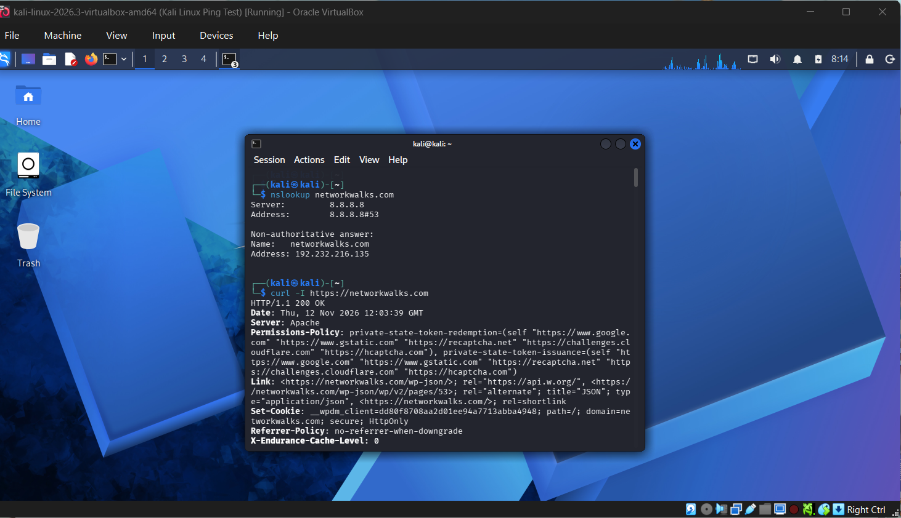
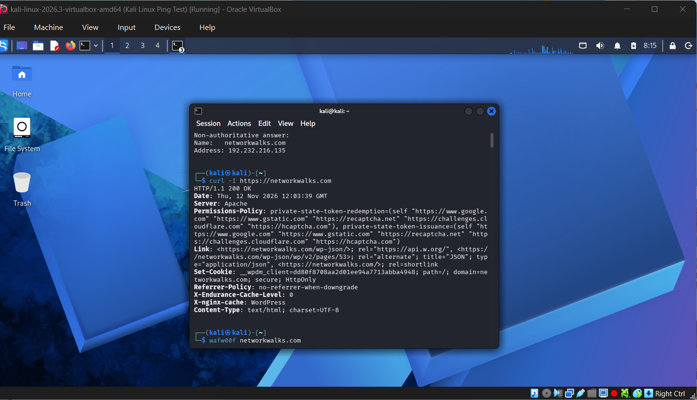
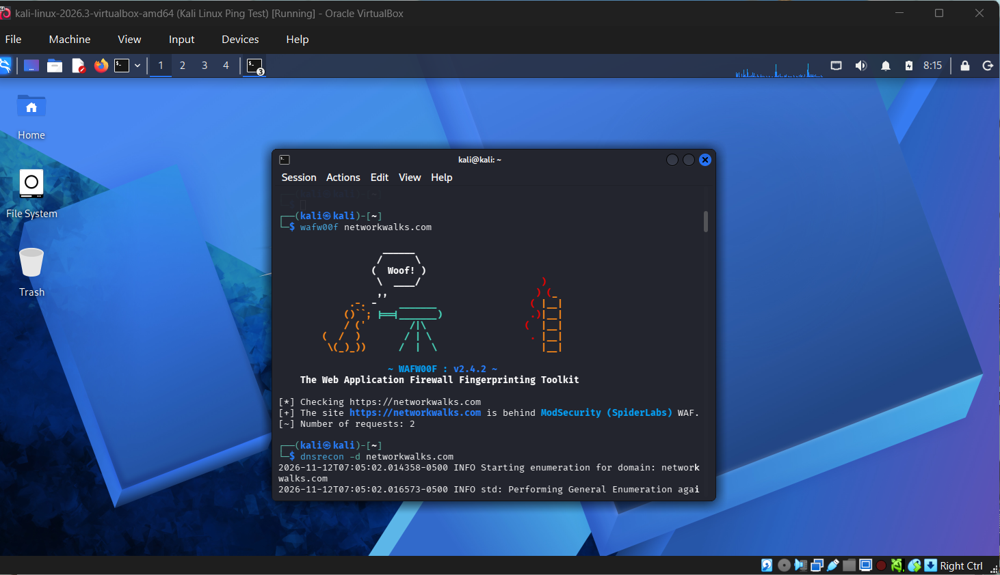
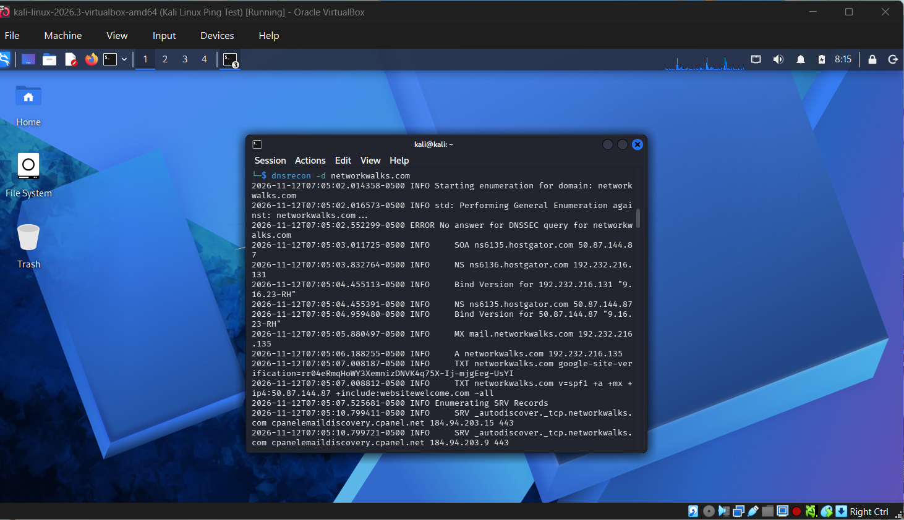
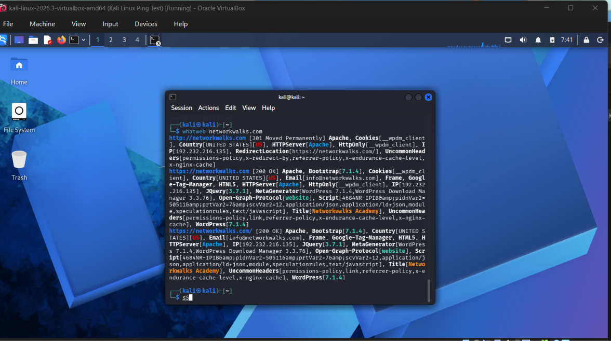
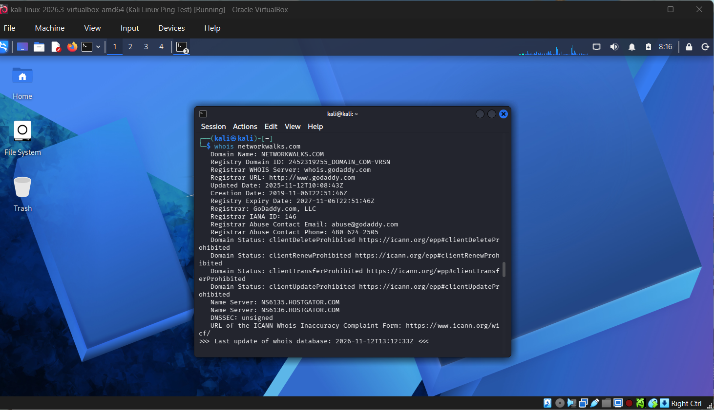
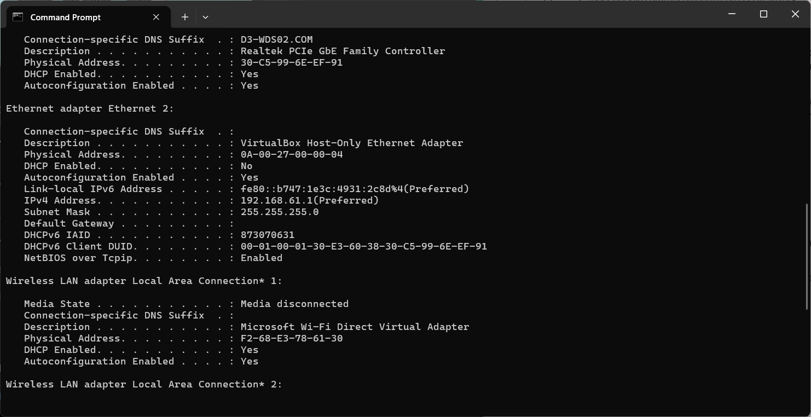
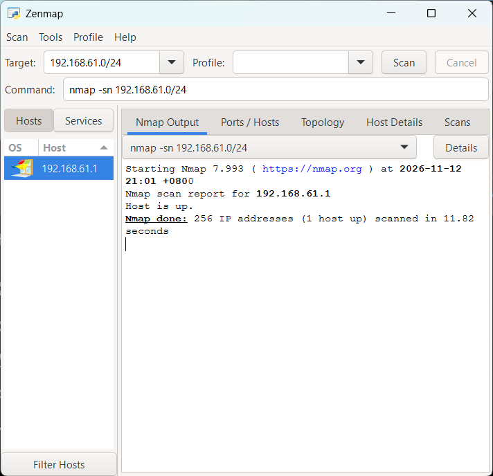

# PENETRATION TESTING REPORT

### Footprinting & Network Scanning Phases

**W2-PM-FINAL | CYBERSECURITY & ETHICAL HACKING | NETWORKWALKS**

---

## Report Information

| Field | Details |
|---|---|
| Pentester Name | Trisha Gayle Dela Cruz |
| Program/Batch | B084 - NetworkWalks |
| Date | 12 November 2026 |
| Modules | W2-PM1: Multiple Kali Linux Tools; W2-PM5: Zenmap Network Scanning |
| Target Domain | networkwalks.com |
| Local Network | Personal Wi-Fi and Oracle VirtualBox Host-Only Network |
| Testing Environment | Kali Linux, Oracle VirtualBox, Windows |
| Authorization | Educational lab; authorized targets only |
| Phases Covered | Phase 1: Reconnaissance & Footprinting; Phase 2: Scanning & Network Discovery |
| Phase 3-5 | In Progress |

---

# 1. Liability Disclaimer

This report documents cybersecurity activities performed for educational and research purposes as part of the NetworkWalks Cybersecurity & Ethical Hacking program.

All security testing must be performed only on systems and networks where proper authorization has been obtained.

The information gathered during these exercises demonstrates reconnaissance, footprinting, network discovery, and security analysis techniques.

No exploitation or unauthorized access was performed during the documented activities.

The instructor, authors, and NetworkWalks are not responsible for the misuse of the information presented in this report.

---

# 2. Introduction

This report documents my Week 2 cybersecurity laboratory activities, focusing on two important phases of penetration testing: **Footprinting and Network Scanning**.

For **W2-PM1**, I used Kali Linux through Oracle VirtualBox to perform reconnaissance on the `networkwalks.com` domain using six different tools: WHOIS, WhatWeb, Nslookup, Curl, WAFW00F, and DNSRecon.

These tools helped me understand how publicly available information can reveal website technologies, domain registration details, DNS records, server information, and security controls.

For **W2-PM5**, I worked with Windows networking commands and Nmap/Zenmap to identify my local network configuration and prepare for host discovery.

The activities helped me practice executing commands, interpreting results, identifying technical information, and troubleshooting errors.

I learned how to use different cybersecurity tools to gather and interpret network information. In particular, Nmap and Zenmap helped me understand IP subnetting and how to identify responding hosts without assuming every device is visible. 

# 3. Tools Used

The following tools were used during the laboratory activities.

| Tool | Purpose |
|---|---|
| Oracle VirtualBox | Runs the Kali Linux virtual machine |
| Kali Linux | Operating system used for reconnaissance activities |
| WHOIS | Retrieves publicly available domain registration information |
| WhatWeb | Identifies website technologies, frameworks, CMS, and plugins |
| Nslookup | Resolves domain names into IP addresses |
| Curl | Retrieves HTTP response headers |
| WAFW00F | Detects Web Application Firewalls |
| DNSRecon | Enumerates DNS records and infrastructure information |
| Nmap | Network scanning and host discovery |
| Zenmap | Graphical interface for Nmap |
| Windows CMD | Identifies local IP addresses, subnet masks, and MAC addresses |

---

# 4. Activities Performed

## 4.1 Footprinting & Reconnaissance (W2-PM1)

**Target Domain:** `networkwalks.com`

**Environment:** Kali Linux 2026.3 running through Oracle VirtualBox

During this module, I performed reconnaissance using six different tools. Each tool was used to gather a different type of information about the target domain.

### Task 1: DNS Lookup Using Nslookup

I used Nslookup to identify the IP address associated with the target domain.

**Command:**

```bash

nslookup networkwalks.com

```

**Results:**

The DNS lookup successfully resolved the domain name.

| Information | Result |
|---|---|
| Domain | networkwalks.com |
| DNS Resolver | 8.8.8.8 |
| Resolved IP Address | 192.232.216.135 |
| Status | Successful |

**Screenshot Evidence:**



**Observation:**

Nslookup demonstrated how DNS translates human-readable domain names into IP addresses.

This information is useful during reconnaissance because it identifies the IP address associated with a website.

However, discovering a public IP address does not automatically indicate a security vulnerability.

---

### Task 2: HTTP Header Inspection Using Curl

I used Curl to inspect the HTTP response headers returned by the website.

**Command:**

```bash

curl -I https://networkwalks.com

```

**Results:**

The website returned an HTTP response indicating that the request was successful.

Some information observed included:

- HTTP Status: 200 OK

- Web Server: Apache

- WordPress-related HTTP headers

- WordPress REST API reference

**Screenshot Evidence:**



**Observation:**

Curl allowed me to examine information returned by the server without navigating through the website's graphical interface.

I learned that HTTP headers may reveal information about the server, website configuration, and technologies being used.

This information can support further authorized security assessment.

---

### Task 3: Web Application Firewall Detection Using WAFW00F

I used WAFW00F to determine whether the target website was protected by a Web Application Firewall.

**Command:**

```bash

wafw00f networkwalks.com

```

**Results:**

The tool identified the following Web Application Firewall:

**ModSecurity (SpiderLabs)**

Additional information:

| Information | Result |
|---|---|
| Target | https://networkwalks.com |
| Tool | WAFW00F |
| Detected WAF | ModSecurity (SpiderLabs) |
| Number of Requests | 2 |
| Status | Successful |

**Screenshot Evidence:**



**Observation:**

WAFW00F helped me understand how security professionals can identify web application firewall technologies.

The detection suggests that the website uses a WAF to help filter potentially harmful web traffic.

However, WAF detection alone does not confirm whether the security configuration is effective against all attacks.

---

### Task 4: DNS Enumeration Using DNSRecon

I used DNSRecon to retrieve additional information about the target domain's DNS infrastructure.

**Command:**

```bash

dnsrecon -d networkwalks.com

```

**Results:**

DNSRecon returned several types of DNS information, including:

- NS records

- MX records

- TXT records

- SPF-related information

- SRV records

- DNS server information

The scan also returned a DNSSEC-related query error, but other DNS records were successfully retrieved.

**Screenshot Evidence:**



**Observation:**

DNSRecon demonstrated how DNS records provide information about the services and infrastructure associated with a domain.

These records may help security professionals understand the infrastructure of a target organization.

I also learned that some commands may return warnings or errors while still producing useful results.

---

### Task 5: Website Technology Fingerprinting Using WhatWeb

I used WhatWeb to identify technologies used by the website.

**Command:**

```bash

whatweb networkwalks.com

```

**Results:**

WhatWeb identified several technologies and website characteristics, including:

- Apache web server

- WordPress

- Bootstrap

- jQuery 3.7.1

- WordPress Download Manager

- Website IP address

- HTTP-related information

The screenshot showed WordPress version 7.1.4 and WordPress Download Manager version 3.3.76 among the reported fingerprints.

These are tool-reported observations and may require further verification.

**Screenshot Evidence:**



**Observation:**

WhatWeb helped me understand how cybersecurity professionals identify the software and technologies used by a website.

This information can be useful for reviewing software versions, understanding web applications, and identifying areas that may require further security assessment.

#### Troubleshooting Encountered

During this activity, I encountered several issues when attempting to run WhatWeb with additional command options.

Some commands returned errors because of incorrect command syntax and accidentally entered terminal characters.

For example, the terminal displayed errors indicating that a command could not be found.

**Troubleshooting Screenshot:**


I reviewed the commands and successfully ran the basic WhatWeb scan.

**What I Learned:**

This experience showed me that command-line tools require accurate syntax.

Even a small typing error can prevent a command from executing properly.

I also learned the importance of reading terminal error messages and checking commands before running them again.

---

### Task 6: Domain Registration Lookup Using WHOIS

I used WHOIS to retrieve publicly available information about the target domain.

**Command:**

```bash

whois networkwalks.com

```

**Results:**

The WHOIS lookup returned information about the domain's registration.

| Information | Result |
|---|---|
| Domain | NETWORKWALKS.COM |
| Registrar | GoDaddy.com, LLC |
| Creation Date | 6 November 2019 |
| Name Server 1 | NS6135.HOSTGATOR.COM |
| Name Server 2 | NS6136.HOSTGATOR.COM |
| Domain Status | Transfer and update restrictions shown |

**Screenshot Evidence:**



**Observation:**

WHOIS provided information about the domain's registration and associated name servers.

I learned that WHOIS can help cybersecurity professionals understand a domain's registration history and infrastructure information.

However, publicly accessible registration information does not automatically indicate a security vulnerability.

---

## 4.2 Network Scanning with Zenmap (W2-PM5)

The second module focuses on network scanning and host discovery.

The objective is to identify the local network configuration, discover live hosts, obtain their IP and MAC addresses, and generate a network topology using Zenmap.

### Task 1: Download and Install Zenmap

I accessed the official Nmap website to obtain the Windows installation package.

**Official Website:**

https://nmap.org/download.html

Zenmap is the graphical user interface of Nmap and provides an easier way to perform network discovery and scanning.

**Screenshot Evidence:**


**Observation:**

I learned that Nmap can be used through the command line, while Zenmap provides a graphical interface that can help beginners manage scans and review results.

---

### Task 2: Identify Local IP Address and LAN Subnet

I opened Windows Command Prompt and used the following command:

```cmd

ipconfig /all

```

The command displayed my network adapters and their configurations.

**VirtualBox Host-Only Network Details:**

| Information | Result |
|---|---|
| Adapter | VirtualBox Host-Only Ethernet Adapter |
| IPv4 Address | 192.168.61.1 |
| Subnet Mask | 255.255.255.0 |
| LAN Subnet | 192.168.61.0/24 |
| Default Gateway | None |
| Physical Address | 0A-00-27-00-00-04 |

**Screenshot Evidence:**



I also identified my active wireless network configuration.

**Wi-Fi Network Details:**

| Information | Result |
|---|---|
| IPv4 Address | 192.168.100.10 |
| Subnet Mask | 255.255.255.0 |
| Default Gateway | 192.168.100.1 |
| LAN Subnet | 192.168.100.0/24 |

**Observation:**

This activity helped me understand the difference between physical and virtual network adapters.

My Wi-Fi adapter connects to the local wireless network, while the VirtualBox Host-Only adapter provides a separate network used for virtual machine communication.

---

### Task 3: Discover Live Hosts Using Zenmap

The purpose of this task is to discover active devices connected to an authorized local network.

For my Wi-Fi subnet, an optional Ping Scan command would be (not used in my documented results):

```bash

nmap -sn 192.168.100.0/24

```

For my VirtualBox Host-Only subnet, I actually ran:

```bash

nmap -sn 192.168.61.0/24

```

The selected network should match the subnet being tested.

**Screenshot Evidence:**



**Observation:**

Zenmap's Ping Scan feature is designed to discover responding hosts without performing a standard port scan.

The Ping Scan of `192.168.61.0/24` completed successfully. Nmap scanned 256 IP addresses and reported **1 host up** (`192.168.61.1`) in **11.82 seconds**. This is my actual scan result, not the instructor’s four-host example.

---

### Task 4: Number of Live Hosts

**Result:** **1 host up** out of 256 IP addresses scanned in `192.168.61.0/24` (11.82 seconds).

---

### Task 5: IP Addresses of Live Hosts

**Result:** `192.168.61.1` (Windows VirtualBox Host-Only adapter).

---

### Task 6: MAC Addresses of Live Hosts

**Result:** `0A-00-27-00-00-04`, identified using Windows `ipconfig /all` for the VirtualBox Host-Only adapter. This MAC address was not displayed in the Zenmap scan screenshot.

For my own Windows network adapter, I used:

```cmd

ipconfig /all

```

This command displays the adapter's Physical Address.

---

### Task 7: Network Topology

The final requirement is to display the discovered network topology and export it in PDF format.

The procedure is:

1. Open the Topology tab in Zenmap.

2. Enable the legend.

3. Review the discovered hosts and connections.

4. Click Save Graphic.

5. Select PDF as the output format.

6. Save the PDF on the Desktop.

**Topology PDF:** Pending final export (not provided in the screenshots).

**Observation:**

A network topology can help visualize discovered hosts and their relationships.

However, the topology is based on the results of the scan and may not represent every physical connection in the network.

---

# 5. Risk Analysis / Impact

Based on the reconnaissance and network scanning activities, I identified several observations that may be relevant to a security assessment.

| # | Finding | Evidence | Potential Impact | Assessment |
|---|---|---|---|---|
| 1 | Website technologies identified | WhatWeb identified WordPress and related technologies | Reveals software information that may support further authorized security assessment | Informational |
| 2 | Public server IP address identified | Nslookup resolved the domain to 192.232.216.135 | Reveals the network address associated with the website | Informational |
| 3 | HTTP information exposed | Curl displayed HTTP response headers | May assist technology identification | Informational |
| 4 | Web Application Firewall detected | WAFW00F identified ModSecurity | Reveals information about the website's security architecture | Informational |
| 5 | DNS infrastructure identified | DNSRecon returned DNS records | Provides information about domain services and infrastructure | Informational |
| 6 | Local network discovery | Zenmap detected one host (`192.168.61.1`) on the Host-Only subnet | Shows which host responded within the lab network; no unknown device was established | Informational |

### Risk Assessment Notes

The observations above are not confirmed security vulnerabilities.

The activities mainly involved information gathering and network discovery.

No exploitation, privilege escalation, or vulnerability validation was performed.

Therefore, the discovery of an IP address, web technology, or DNS record does not automatically mean that a website or network is vulnerable.

Additional authorized testing would be required to validate actual security weaknesses.

---

# 6. Recommendations

Based on my observations, I recommend the following security practices.

### 1. Keep Website Technologies Updated

Organizations should regularly update their web servers, content management systems, plugins, and other website components.

### 2. Review Publicly Exposed Information

Organizations should periodically review publicly accessible technical information and remove unnecessary disclosures where practical.

### 3. Review HTTP Security Headers

HTTP response headers should be checked to determine whether appropriate security headers are configured.

### 4. Monitor DNS Configurations

DNS records should be reviewed regularly to identify outdated entries, unnecessary services, and configuration issues.

### 5. Maintain Web Application Firewall Protection

Web Application Firewall configurations should be maintained, monitored, and reviewed regularly to provide effective protection.

### 6. Perform Authorized Network Scanning

Organizations should periodically scan their own networks to identify active devices and maintain visibility over their infrastructure.

### 7. Investigate Unknown Devices

Unexpected devices discovered during network scans should be verified and investigated.

### 8. Maintain Updated Network Documentation

Network topology diagrams and device inventories should be maintained to support troubleshooting and security management.

### 9. Follow Ethical Hacking Principles

Security testing should only be performed on networks and systems where proper authorization has been obtained.

---

# 7. Conclusion

During Week 2 of my NetworkWalks Cybersecurity & Ethical Hacking training, I gained practical experience using different reconnaissance tools in Kali Linux and identifying network information through Windows.

For the footprinting activity, I used six tools: WHOIS, WhatWeb, Nslookup, Curl, WAFW00F, and DNSRecon.

Each tool helped me understand a different aspect of information gathering.

WHOIS provided domain registration details, WhatWeb identified website technologies, Nslookup resolved domain names into IP addresses, Curl displayed HTTP response headers, WAFW00F detected a web application firewall, and DNSRecon provided additional DNS infrastructure information.

One of the challenges I experienced involved errors while using WhatWeb. I initially entered incorrect commands and encountered terminal errors. After reviewing the command syntax, I was able to perform the scan successfully.

For the network scanning module, I identified my local IP addresses and subnet configurations using Windows Command Prompt. A Zenmap Ping Scan of my VirtualBox Host-Only subnet (`192.168.61.0/24`) detected one live host (`192.168.61.1`).

I also learned the difference between my actual Wi-Fi network and the Host-Only network created by Oracle VirtualBox.

Overall, these activities strengthened my understanding of reconnaissance, network discovery, troubleshooting, and cybersecurity documentation.

I learned that information gathering is an important part of cybersecurity because it helps security professionals understand systems and networks before conducting further assessments.

I also learned that discovering technical information does not automatically mean a system is vulnerable.

Most importantly, cybersecurity activities must always be performed responsibly and within an authorized scope.

---

# 8. Evidence Collected

The following screenshots document my laboratory activities.

All screenshot files are stored in the `screenshots/` folder.

## Evidence 1: Nmap Official Download Page


## Evidence 2: Windows VirtualBox Network Adapter


## Evidence 3: Nslookup Results


## Evidence 4: Curl HTTP Header Inspection


## Evidence 5: WAFW00F Detection


## Evidence 6: DNSRecon Enumeration


## Evidence 7: WhatWeb Technology Fingerprinting


## Evidence 8: WhatWeb Troubleshooting


## Evidence 9: WHOIS Domain Information


## Evidence 10: Zenmap Network Scanning


---

# 9. References

1. NetworkWalks. Cybersecurity & Ethical Hacking Training Program.

   https://networkwalks.com/

2. Nmap Project. Nmap and Zenmap Documentation.

   https://nmap.org/

3. Kali Linux. Official Documentation.

   https://www.kali.org/docs/

4. Oracle. VirtualBox Documentation.

   https://www.virtualbox.org/wiki/Documentation

---

**Disclaimer:** This documentation is intended for educational cybersecurity training only. All testing must be performed with proper authorization.
